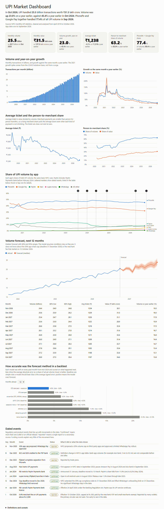

# UPI Payments Analysis

An end-to-end analysis of India's UPI payments data from NPCI, April 2019 to October 2026: cleaning, statistics, time series diagnostics, a 12-month forecast and an interactive dashboard.

**Live dashboard:** https://megha9306.github.io/upi-payments-analysis/



## What I found

- **The falling average ticket is a mix effect.** The average payment fell from ₹1,817 to ₹1,238, but person-to-person tickets are flat (₹2,326 to ₹2,328) and merchant tickets rose (₹514 to ₹603). Merchant payments, which are smaller, grew from 45% to 63% of volume.
- **Growth is slowing steadily.** Volume is up 23% on a year earlier, against 45% two years ago.
- **The top of the market is stable.** PhonePe and Google Pay hold about 80% of volume, and that share has not moved significantly.
- **Paytm's decline accelerated after RBI's 2024 action on Paytm Payments Bank.** Its share fell from 12.5% to 7.8%, and PhonePe and Google Pay took about three quarters of the loss.
- **A damped-trend forecast beats constant-growth models.** At 12 months ahead the backtest error was 4.0%, against 8.5% for the best simple baseline. Models that assume constant growth over-forecast by 6% to 14%.

The full write-up, with confidence intervals and what the data cannot support, is in [`analysis/FINDINGS.md`](analysis/FINDINGS.md).

## Repository layout

| Folder | Contents |
|---|---|
| `Raw data/` | NPCI product statistics (xlsx) and the converted monthly CSVs |
| `Scraper/` | Raw NPCI responses (JSON) and the scripts that convert and clean them |
| `cleaning/` | Cleaned datasets: product totals, P2P/P2M split, app volumes, and the app name map |
| `analysis/` | Scripts `01` to `07`, result tables in `data/`, charts, and `FINDINGS.md` |
| `analysis/dashboard/` | Dashboard page source and the two build scripts |
| `docs/` | The built dashboard, served by GitHub Pages |

## How the data was cleaned

- 343 raw app names were merged into 145 canonical apps, using an explicit, reviewable alias map (`cleaning/apps_name_map.csv`).
- A parsing bug that turned values with thousands separators (for example `"26,510.97"`) into blanks was fixed.
- App totals ran about 2% above the headline because NPCI's app table includes on-us transactions and the headline excludes them. App shares use the headline-consistent volume.
- Figures were checked against published reports: super.money, Google Pay and WhatsApp volumes matched exactly, and Paytm, PhonePe and Navi shares matched to about 0.1 to 0.6 percentage points.

## Reproduce the analysis

Requires Python 3 with `pandas`, `numpy`, `scipy`, `statsmodels` and `matplotlib`. Scripts use Windows-style relative paths and are run from their own folder.

```
cd analysis
python 01_build_master.py
python 02_eda.py
python 03_trends.py
python 04_correlation.py
python 05_stats_tests.py
python 06_timeseries_diagnostics.py
python 07_forecast.py

cd dashboard
python build_dashboard_data.py
python build_local_dashboard.py     # writes UPI_Dashboard.html and docs/index.html (downloads d3 if missing)
```

The analysis reads the cleaned files in `cleaning/`. The earlier scripts in `Scraper/` (`convert_all.py`, `clean_product.py`, `clean_apps.py`, `clean_p2p.py`) produce those files from the raw data, but they assume the raw files sit beside them, so they need path adjustments to run from this layout. The script that originally downloaded the raw NPCI responses is not included.

## Limitations

- Only about 65 post-COVID months are available, so forecasts beyond roughly six months are trend extrapolation. Intervals are wide for the same reason.
- The forecast assumes conditions stay as they are. It does not model the 30% app market-share cap (deadline 31 December 2026) or the 0.4% merchant fee that applied from 15 October 2026.
- Per-bank app volumes (SBI, HDFC, ICICI, Axis, Kotak) could not be checked against an external source.
- Several events (such as WhatsApp's onboarding cap removal) could not be shown to have a measurable effect.

## Data and attribution

The data are public statistics published by the National Payments Corporation of India (NPCI). This repository is an independent analysis and is not affiliated with NPCI. Check NPCI's terms before reusing the raw data. The dashboard embeds D3 v7.8.5 (ISC licence), which the build script downloads on first run.

## Author

Megha Pareek
